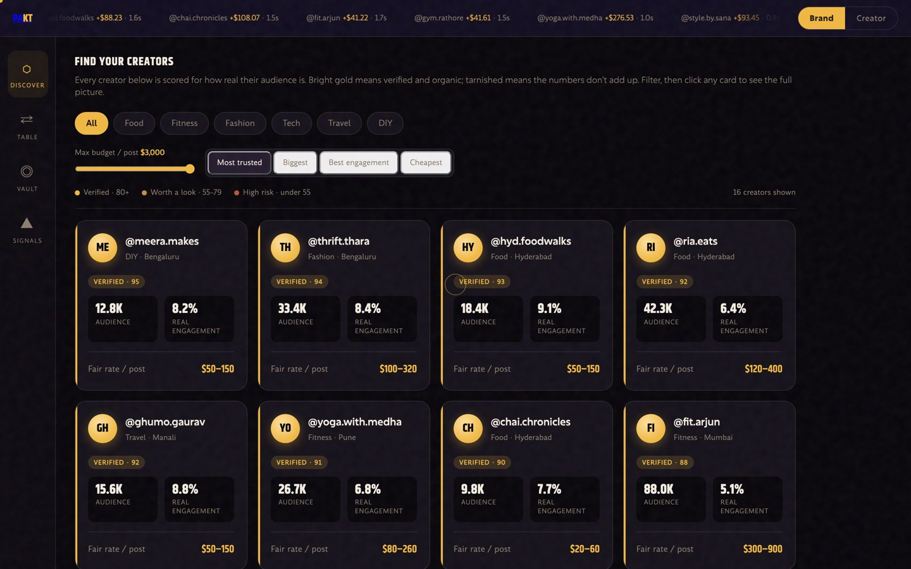
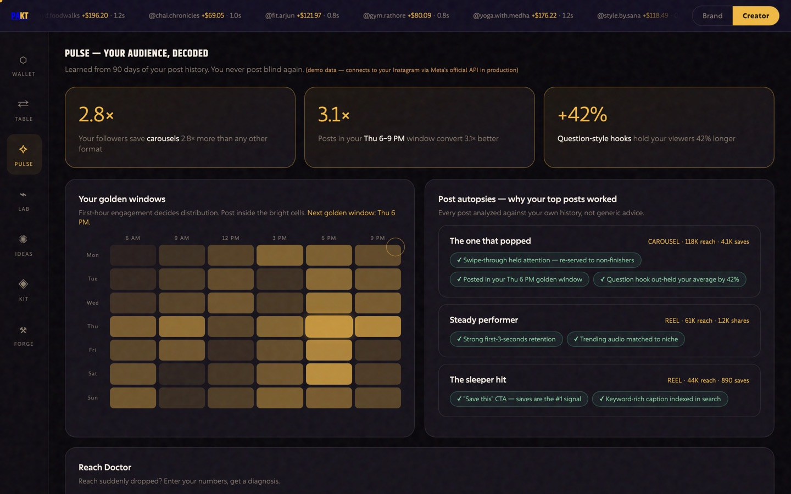
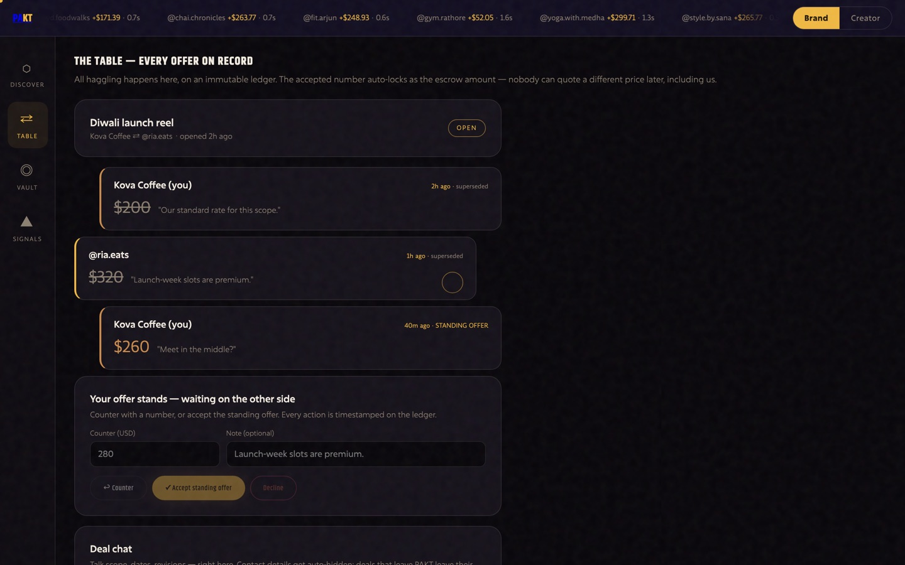
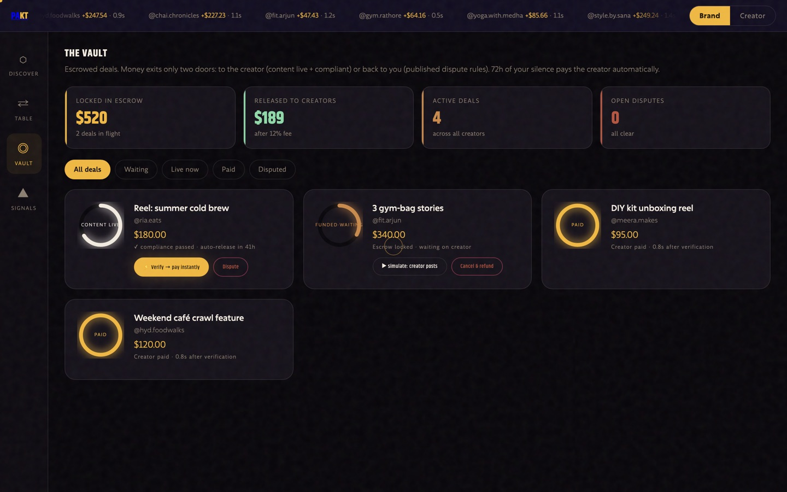

# PAKT

**An escrow rail for creator–brand deals.** The brand's money is locked before the creator starts work, and released the instant the post is verified live and compliant. Built for India, where a nano-creator's standard payment cycle is 30–90 days and frequently never.

> **Zero runtime dependencies.** No `node_modules`, no framework, no ORM. The whole backend is 2,781 lines of plain JavaScript on Node's built-in HTTP server and built-in SQLite. `npm install` does nothing, because there is nothing to install.

```bash
node server.js     # API + app on http://localhost:4000
node test.js       # 190 end-to-end assertions against the real server
```

---


---

## Why this repo might be worth your time

Most side projects are a CRUD app with a payment button. This one is a **state machine that holds other people's money**, and nearly all of the interesting work is about a single question:

**What is a timer allowed to decide?**

Once you hold both sides' funds, every automatic action is an ethical position. An earlier build of the dispute system auto-settled in the creator's favour at the deadline whenever the content was compliant and they had responded. That rule paid a creator who delivered one story against a three-story brief and then filed a one-line non-answer — because the rule tested *compliance* and *responsiveness* and never tested *delivery*.

Whether a brief was met is a judgement call, and a clock cannot make it. So the deadline now **escalates loudly and holds the funds**. It never decides. That reasoning is written into [`lib/escrow.js`](lib/escrow.js) next to the code it governs, because the next person to read it will otherwise "simplify" it straight back into the bug.

The source comments throughout this repo narrate decisions like that one — what the previous version did, why it was wrong, and what replaced it. **That is deliberate, and it is the part of this codebase I would point at first.**

## Screens

| Creator discovery, scored for authenticity | Audience intelligence |
|---|---|
|  |  |

| The Table — structured negotiation | The Vault — escrow lifecycle |
|---|---|
|  |  |

`demo/screens/` has the full set. [`walkthrough.html`](walkthrough.html) is a self-contained narrated tour — open it directly in a browser, no server needed.

## What the backend guarantees

| Guarantee | How |
|---|---|
| Creators are paid instantly | Payout fires inside the same transaction as verification |
| Brands cannot ghost | 72h after submission escrow auto-releases to the creator — swept on a 60s timer, not only when someone opens the app |
| Nobody wins a dispute by waiting | Every dispute carries a 7-day deadline, warned 24h out and **escalated** at the deadline with funds held. No side is ever paid or refunded by a timer |
| Both sides are heard | The creator has their own endpoint to answer a dispute and file evidence |
| Brands cannot be scammed | Money leaves escrow only when content is live and compliant, or by operator decision |
| No double charges or double payouts | Idempotency keys enforced on every money movement |
| No illegal states | Explicit transition map; anything not in it is a 409 |
| FTC/ASCI compliance autopilot | Captions without `#ad` / `#sponsored` / "paid partnership" are rejected at submission; buried disclosure is flagged as an advisory |
| Fraud transparency | Every creator carries an authenticity score (0–100) with human-readable flags — or `unverified` when we simply have no stats |
| Creators can reconcile | The wallet shows gross → platform fee → net, per currency |
| Private commercials | The audit log is scoped to the caller — your rates are not readable by other creators |
| Stats have public provenance | Every change to a creator's audience numbers is recorded with before/after values. Three separate edits in a week costs the `verified` badge |
| Account age is bounded | It cannot exceed Instagram's own age, go backwards, or grow faster than time does |
| Agreed prices stay agreed | The accepted offer is hashed into the deal. There is no path from an agreement to a different number |

### Deal lifecycle

```
DRAFT ──fund──▶ FUNDED ──submit──▶ CONTENT_SUBMITTED ──verify──▶ PAID
                  │                     │       ▲
               cancel                dispute  auto-release (72h)
                  ▼                     ▼
              REFUNDED              DISPUTED ──resolve (operator)──▶ PAID | REFUNDED
                                        └── 7-day SLA ──▶ ESCALATED (funds stay in escrow)
```

**The dispute rule, published so both sides can predict it:** content that is live at the agreed URL and passed compliance is paid, unless the brand shows a concrete brief violation.

## Three decisions worth reading the code for

**Money is never a float.** All amounts are integer minor units — `50000` means `500.00`. The currency travels through the accepted-offer hash into the deal and onto every ledger row, because deriving it later is guesswork. [`lib/escrow.js`](lib/escrow.js)

**Missing data is not a risk signal.** The fraud score originally gave a creator who skipped the optional fields 45/100 and the flag *"engagement far below organic norms"* — describing data that never existed. It now returns `unverified`, which is what it always was. Separately, a flat engagement ceiling let a 200k account claim a 21% engagement rate and score 85/"verified", out-ranking an honest one; the ceiling now scales with audience size, because falling engagement at scale is the entire tell. [`lib/services.js`](lib/services.js)

**The standing offer must be deterministic.** `latestOffer()` ordered by `(created_at DESC, id DESC)`. `created_at` is `Date.now()`, so two offers exchanged inside the same millisecond tie — and the tiebreaker, `id`, is nine *random* bytes. Ties were broken at random. It surfaced as a flaky test, but this function picks the price that gets frozen into the terms hash. Fixed by ordering on SQLite's monotonic `rowid`, with a regression test that fires four offers with no delay to force the tie. [`lib/negotiate.js`](lib/negotiate.js)

## Architecture

```
server.js          44 routes, a regex table, zero middleware
lib/
  escrow.js        the money state machine — every transition explicit
  negotiate.js     structured negotiation, immutable offer ledger, SHA-256 terms hash
  auth.js          scrypt passwords, hashed sessions, role guards
  net.js           client IP behind proxies, tiered rate limits, CSP and headers
  services.js      payments adapter, fraud score, compliance, rate benchmarks
  studio.js        creator intelligence — all deterministic, seeded per creator
  discovery.js     Instagram prospects, kept strictly apart from real users
  ig-graph.js      Meta Business Discovery client
  db.js            12 tables, additive idempotent migrations
  util.js          self-describing validators
  taxonomy.js      one canonical niche vocabulary, shared by every engine
  roi.js           click/conversion attribution
```

The frontend is four single-file pages, 5,015 lines, no build step:

- [`index.html`](index.html) — landing page, with a WebGL "trading floor"
- [`app.html`](app.html) — the product: nine screens, brand and creator modes
- [`forge.html`](forge.html) — a browser-native photo and reel editor (128 functions, canvas-based auto-grading, masks, layers, velocity ramps, MediaRecorder export) with no dependencies and nothing uploaded anywhere
- [`walkthrough.html`](walkthrough.html) — self-contained narrated tour

## Security posture

| Surface | Handling |
|---|---|
| Passwords | scrypt, 16-byte random salt, 32-byte key, versioned prefix for rotation, `timingSafeEqual` compare |
| Sessions | 24 random bytes, stored **SHA-256 hashed** — a database leak yields no usable tokens. Revocable, mass-revoked on password change, expired rows swept every 60s |
| Brute force | Per-IP *and* per-account. 8 failures in 15 minutes and the account stops answering for a cooldown — a cooldown, not a permanent lock, because a permanent lock hands anyone who knows your email a DoS button |
| Client identity | `X-Forwarded-For` ignored unless `PAKT_TRUST_PROXY` is set, and then only from a loopback/RFC1918 peer, reading the **rightmost** entry — the one the proxy observed, not the one the client claimed |
| Privilege | `is_admin` comes only from `PAKT_ADMIN_EMAILS`. No request body can set it, and a test tries |
| Headers | CSP with script pinned to the two CDNs actually used, `frame-ancestors 'none'`, nosniff, Referrer-Policy, Permissions-Policy denying camera/mic/geo, and HSTS **only** when the request arrived over TLS |
| SQL | Every statement parameterised. The two dynamic `SET` clauses build column names from an allowlisted spec, never from request keys |
| Static files | An allowlist map of URL → literal filename. No path join against input, so there is no traversal to attempt |

Known and deliberate: `'unsafe-inline'` is in the CSP, because every page is a single file with inline styles and script. What the policy still buys is that script cannot come from an arbitrary host, the page cannot be framed, and forms cannot post elsewhere.

## Configuration

| Var | Default | What it does |
|---|---|---|
| `PORT` | `4000` | HTTP port |
| `PAKT_DB` | `./pakt.db` | SQLite file. Migrations are additive and idempotent — an existing DB upgrades in place on boot |
| `PAKT_ADMIN_EMAILS` | *(empty)* | Operator emails, comma-separated. The **only** way to get `is_admin`. With none set the dispute SLA sweep does nothing at all, because escalating to an empty room is theatre |
| `PAKT_HOST` | `0.0.0.0` | Bind address. Set `127.0.0.1` behind a reverse proxy so the origin cannot be reached directly |
| `PAKT_TRUST_PROXY` | `0` | Number of proxies in front. Behind Caddy/nginx set `1`, or every request appears to come from `127.0.0.1` and the whole internet shares one rate-limit bucket |
| `PAKT_RATE_LIMIT` | `120` | Global requests/minute/IP |
| `PAKT_RATE_LIMIT_AUTH` | `10` | `/api/login` and `/api/signup` |
| `PAKT_RATE_LIMIT_MONEY` | `30` | fund · verify · cancel · resolve · to-deal |
| `PAKT_RATE_LIMIT_WRITE` | `60` | every other mutating request |
| `PAKT_CORS_ORIGINS` | *(empty)* | Origin allowlist. Empty means same-origin only |

See [`.env.example`](.env.example). **Requires Node 23.4+** (24 LTS recommended), where `node:sqlite` is unflagged — `lib/db.js` checks on boot and tells you which case you are in rather than dying on `ERR_UNKNOWN_BUILTIN_MODULE`.

## API

Auth is `Authorization: Bearer <token>`. Money movements require an `Idempotency-Key` header of 8+ characters.

```
GET    /api/health
GET    /api/meta                      niches, currencies, fee, states, SLA windows   [public]

POST   /api/signup                    creators also require handle, niche, followers, avg_likes, avg_comments
POST   /api/login
POST   /api/logout                    revoke this session
GET    /api/me
PATCH  /api/me                        a wrong signup is fixable
POST   /api/me/password               rotates and signs out every device

GET    /api/creators                  profiles + authenticity score + rate benchmark
GET    /api/creators/discover         imported Instagram creators who have not joined
GET    /api/benchmarks                ?followers=42000&niche=food

POST   /api/deals                     [brand]
PATCH  /api/deals/:id                 edit a DRAFT — refused once funded
DELETE /api/deals/:id
POST   /api/deals/:id/fund            [brand] Idempotency-Key required
POST   /api/deals/:id/submit          [creator] compliance-checked
POST   /api/deals/:id/verify          [brand] → instant payout
POST   /api/deals/:id/cancel          [brand] only while FUNDED
POST   /api/deals/:id/dispute         [brand]
GET    /api/deals · GET /api/deals/:id

POST   /api/disputes/:id/respond      [creator] their side of the record
GET    /api/disputes[?status=open|escalated]
POST   /api/disputes/:id/resolve      [operator]

POST   /api/negotiations              [brand] open with the first offer
POST   /api/negotiations/:id/counter  strict alternation
POST   /api/negotiations/:id/accept   freezes terms with a SHA-256 hash
POST   /api/negotiations/:id/message  contact details redacted before storage
POST   /api/negotiations/:id/to-deal  creates the deal at exactly the agreed price

GET    /api/studio/*                  insights · hook · caption · ideas · reach · mediakit
GET    /t/:code                       tracking redirect
GET    /api/deals/:id/roi             clicks, conversions, revenue, ROAS, CPC
GET    /api/wallet                    gross → fee → net, per currency   [creator]
GET    /api/audit                     scoped to events you are a party to
```

## Tests

`node test.js` spins the real server against a throwaway database and runs **190 assertions** across 30 sections. They are written as claims about behaviour, not about functions:

```
✔ is_admin cannot be smuggled in through signup
✔ idempotent retry does not double-charge
✔ missing #ad disclosure blocked (compliance autopilot)
✔ 72h silence → creator auto-paid
✔ no payout row was written for an escalated dispute
✔ a 21% engagement rate at 210k followers no longer reads as "verified"
✔ three separate edits in a week costs the verified badge
✔ a 50-year-old Instagram account is rejected at signup
✔ spelling the digits out is not a way around the contact filter
✔ the standing offer is the last one inserted, not a random one of the tied pair
✔ prospects never leak into /api/creators
```

## Deploying

[`deploy/DEPLOY.md`](deploy/DEPLOY.md) is a full runbook for a free always-on VM with automatic HTTPS, plus [`deploy/bootstrap.sh`](deploy/bootstrap.sh) (one command), [`deploy/Caddyfile`](deploy/Caddyfile) and a sandboxed [`deploy/pakt.service`](deploy/pakt.service).

One constraint decides the hosting choice: **a free tier that sleeps when idle silently breaks the 72h auto-release**, because that guarantee is enforced by a 60-second timer inside the process. Serverless is the wrong shape here, and so is anything with an ephemeral filesystem.

## Status — what is real, what is not

This is a working pre-launch build, not a live product. Being specific about that:

**Real:** the escrow state machine, the ledger, idempotency, disputes and the SLA, negotiation and the terms hash, compliance checking, the fraud score, contact redaction, the audit log, sessions and the security posture above, and the entire frontend.

**Simulated:** `payments.chargeBrand` and `payments.payoutCreator` in [`lib/services.js`](lib/services.js) return synthetic references. They are called only from inside the state machine, so swapping in Razorpay Route or Stripe Connect is a two-function change — and provider failure is already handled safely, with funds staying in escrow.

**Demo data:** Creator Studio's insights are deterministic and seeded per creator, standing in for the Meta Graph API post history that requires App Review. The API labels them as such rather than presenting them as measured.

**Known gaps, found by persona-testing and not yet built:**

- **Disclosure detection is English-only.** A caption disclosed properly in Hindi or Punjabi is rejected, while an English `#ad` bolted onto a Hinglish caption passes. This is backwards for ASCI and is the largest gap for the stated market.
- Caption and hook scoring are Latin-script only, so Studio is near-useless for a non-English creator.
- No barter/gifted deal type — the most common nano-tier arrangement in India cannot be recorded at all.
- No manager/agency role. Agencies today share creator passwords, and third-party commission is invisible to the fee maths shown to creators.
- No account recovery. A password can be changed and a session revoked, but a forgotten password has no path back — there is no email delivery in the stack, and a reset flow without one is a lie.
- The operator dispute queue is API-only; there is no console screen for it.
- `GET /api/creators` ignores every query parameter — no filter, search or pagination.
- No FX: benchmarks and rate cards are quoted in USD regardless of deal currency.

## License

MIT — see [LICENSE](LICENSE).
